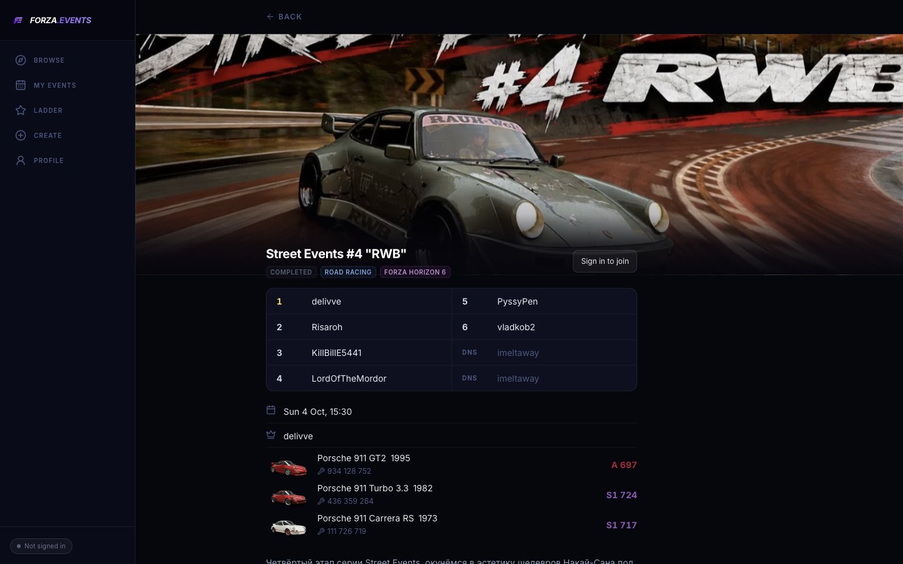
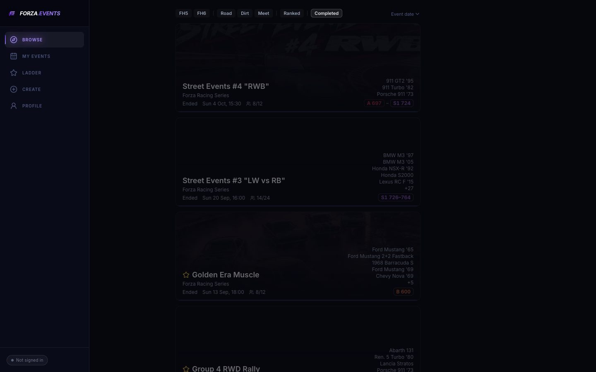
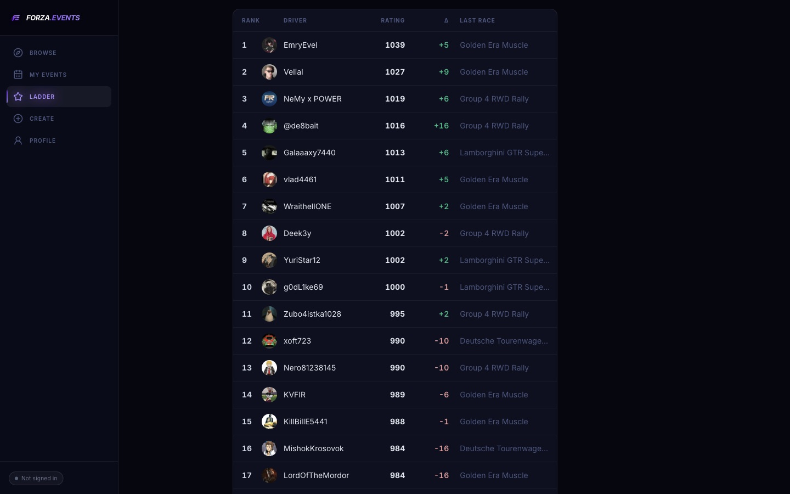
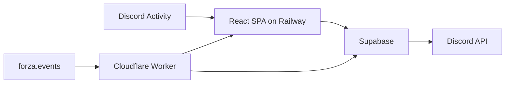

# FORZA.EVENTS

Community races, cruises, and meets for **Forza Horizon 5** and **6**. A host publishes an event into a Discord channel. Players find it in a cross-server feed, join with an Xbox gamertag, and follow results on a ranked ladder.

**Live:** [forza.events](https://forza.events) — guest site, and a Discord Activity (App Launcher or the button on a published card).



*Event page. Standings, convoy leader, and the restricted car list with PI class.*

Feature development on this repository has stopped. Production stays up. The tree is the record of how the app was built.

## What it does

- **Browse** road races, dirt races, and meets. Filter by game, type, and ranked.
- **Event page** with convoys of 12, a waitlist, convoy leaders, car rules, and results (finish, DNF, DNS).
- **Create and publish** into a Discord server and channel the host can manage. The card updates as people join.
- **Ranked ladder** — pairwise ELO for races on an allowlisted server, with the last race and the rating change on each row.
- **Guest site and Activity.** Browse, event pages, and the ladder work signed out. Join, create, and profile ask for Discord.
- **English and Russian.**



*Browse. Finished events stay in the feed and are dimmed.*



*Ladder. Rating, last change, and a link to that race.*

## How the pieces connect



The constraints that shaped the code are Discord's:

- The Activity runs in an iframe. Native `alert` / `confirm` are blocked, and `` cannot load `*.supabase.co`, so covers go through a URL map. Auth is a Discord token exchange, not a Supabase user session.
- On `forza.events`, the app calls same-origin `/supabase/*`. A Worker proxies that to Supabase, and returns link-preview HTML to crawlers, plus `robots.txt` and a sitemap.
- Publish posts a Discord Components V2 message. Server, channel, and game stay locked after that message exists. Join and Open launch the Activity.
- Capacity is enforced in Postgres, including two people joining the last seat at once. A host can open up to five convoys. Leaving a seat promotes the next waitlisted player into that convoy.
- After the host submits standings, ranked races apply one pairwise ELO update per convoy.

## Stack

| | |
|---|---|
| UI | React 18, Vite, TypeScript, Tailwind |
| Discord | Embedded App SDK; bot token for cards, interactions, and DMs |
| Data | Supabase Postgres, Row Level Security, Storage, 23 Edge Functions |
| Edge | Cloudflare Worker |
| Hosting | Railway |
| Languages | English and Russian |

## Run locally

```bash
cp .env.example .env
npm install
npm run dev
```

Open http://localhost:5180. Browse works with the anon key. Sign in with Discord for join, create, and publish. Environment variables, OAuth redirects, and deploy commands are in [`docs/DEVELOPMENT.md`](docs/DEVELOPMENT.md).

## Repository

```
src/            React app
cloudflare/     Worker: Supabase proxy, link previews, sitemap
supabase/       migrations 001–043, Edge Functions
scripts/        deploy, car catalog, covers
docs/           product contract, status, QA notes
```

| Doc | What it is |
|---|---|
| [`docs/STATUS.md`](docs/STATUS.md) | What shipped |
| [`docs/PLAN.md`](docs/PLAN.md) | Product contract |
| [`PRODUCT.md`](PRODUCT.md) | Who it is for |
| [`DESIGN.md`](DESIGN.md) | Visual tokens |
| [`docs/DEVELOPMENT.md`](docs/DEVELOPMENT.md) | Local setup and deploy |
| [`docs/BACKLOG.md`](docs/BACKLOG.md) | Ideas that were not built |
| [`supabase/README.md`](supabase/README.md) | Schema and functions |
| [`AGENTS.md`](AGENTS.md) | Implementation notes |

## Status

Shipped and live. No further feature work is planned here. Unbuilt ideas are listed in [`docs/BACKLOG.md`](docs/BACKLOG.md); that list is not a roadmap.

Forza and Forza Horizon are trademarks of Microsoft. This project is not affiliated with Microsoft.
